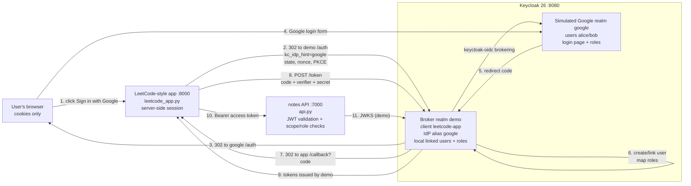
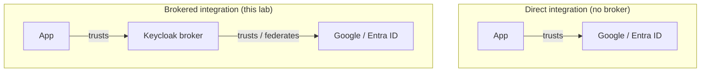
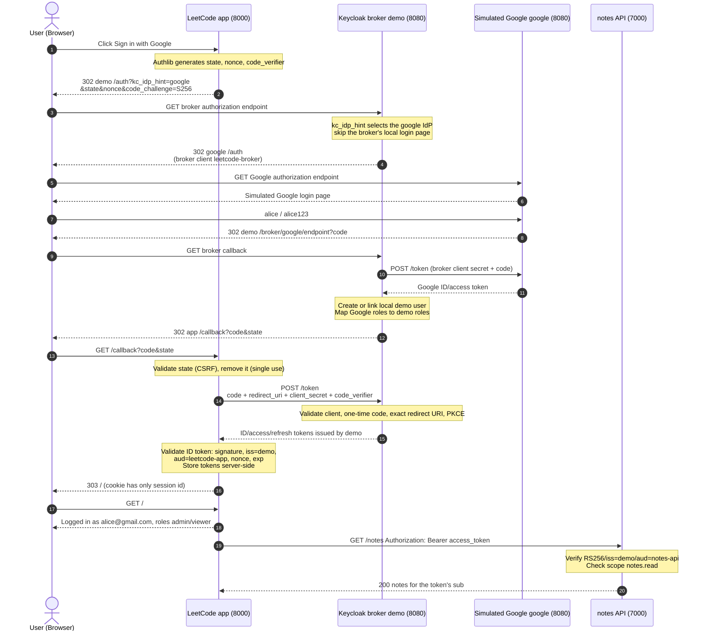
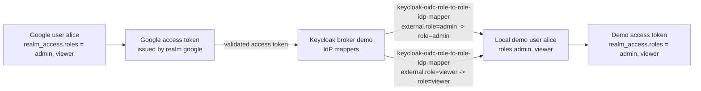
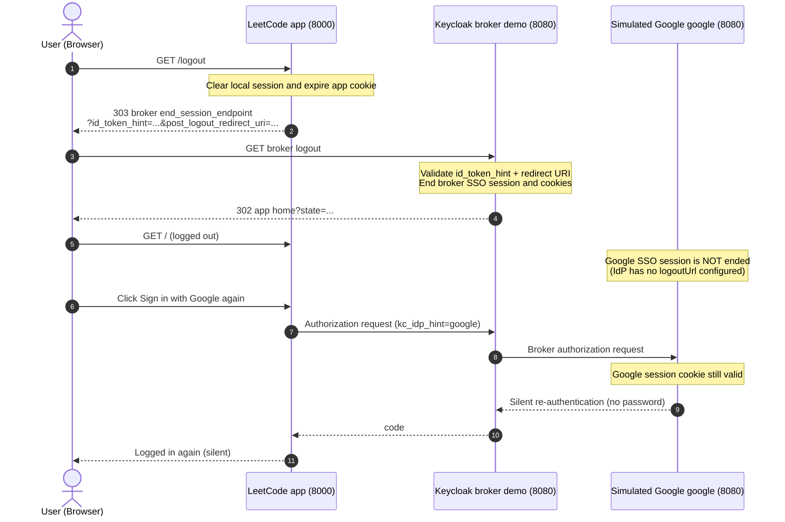
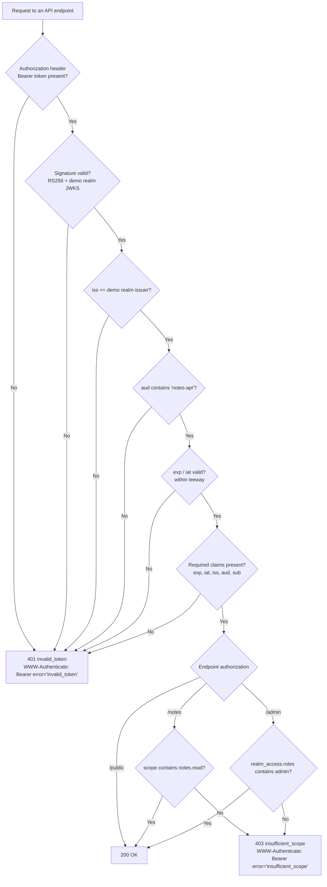
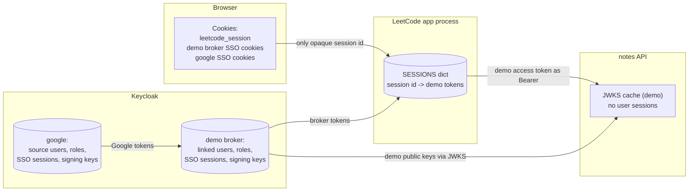

# Broker Lab — Diagrams

Mermaid diagrams for the Keycloak-broker + simulated-Google setup. They render on
GitHub/GitLab and in editors with Mermaid support.

---

## 1. Architecture

The app trusts **only** the broker realm (`demo`). It never sees the Google
realm's tokens. The broker realm is the only IdP the app needs to know about.

---

## 2. Direct IdP vs brokered IdP

Brokering lets one app trust a single IdP (Keycloak) while Keycloak handles many
upstream providers. It also centralizes role mapping, user linking, and policy.

---

## 3. Brokered login sequence

---

## 4. Role mapping from Google to the broker

The app receives the demo token, so it sees `realm_access.roles` as mapped by
Keycloak. The Google realm remains the source of authentication and role
assignment; the broker owns the local authorization model.

---

## 5. Logout: broker session vs Google session

This mirrors the real world: logging out of LeetCode does not log you out of
Google. If you want “log out everywhere”, you must also invoke the upstream
IdP’s logout and handle its redirect URI; that is deliberately out of scope here.

---

## 6. API token validation and 401 vs 403

**401** = authentication failed (missing, expired, bad signature, wrong issuer,
wrong audience). **403** = authentication succeeded but the valid token lacks the
required scope or role.

---

## 7. Where tokens and sessions live

- The browser holds only cookies, never app tokens.
- The app stores **demo-issued** tokens server-side.
- The Google realm's tokens stay inside Keycloak's brokering logic.
- The API is stateless: it caches the **demo** realm’s public keys and validates
  tokens locally.
